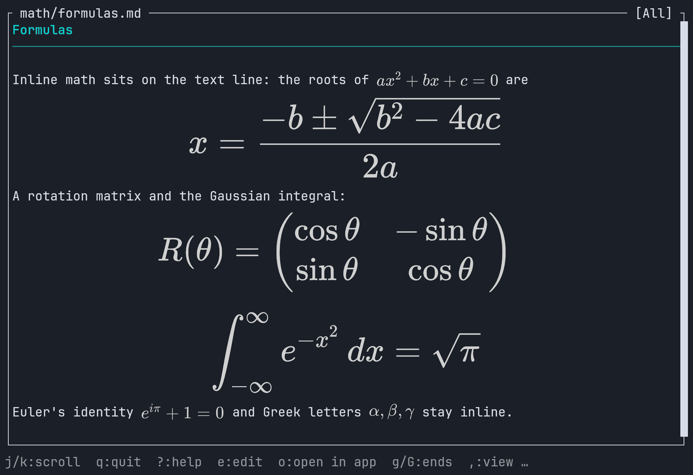

# konoma-math

LaTeX math for [konoma](https://github.com/LESIM-Co-Ltd/konoma), a terminal file browser: the
renderer and the plugin that draws the formulas in konoma's Markdown preview.



*Screenshot taken in [konoma-markdown](https://github.com/LESIM-Co-Ltd/konoma-markdown); the standalone `konoma-math` program cannot open files.*

| Crate | What it is |
| --- | --- |
| [`konoma-math-core`](crates/konoma-math-core/README.md) | Library: a LaTeX formula to a standalone SVG, through RaTeX. |
| [`konoma-math`](crates/konoma-math/README.md) | konoma's `math` plugin, built on the core. Already part of konoma. |

## Try it

konoma has the plugin built in, so nothing from this repository has to be installed. With konoma
installed, save this as `formulas.md`:

```markdown
Inline $E = mc^2$ in a sentence.

$$\int_0^1 x^2 \, dx = \frac{1}{3}$$
```

and open it:

```sh
konoma formulas.md
```

The `samples/` directory here holds files for checking syntax highlighting; it has no formula
example.

## Build and test

Rust 1.92 or later.

```sh
cargo build
cargo test
```

CI runs on macOS and Ubuntu, with and without default features, and also checks formatting and
clippy. On Ubuntu it first installs `pkg-config`, `cmake`, `libssl-dev` and `zlib1g-dev`.

## License

MIT. See [LICENSE](LICENSE).
