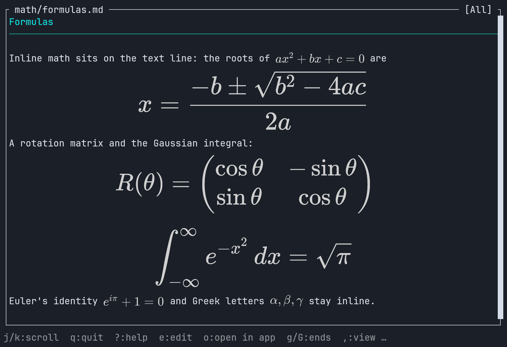

# konoma-math-core

A LaTeX math expression to a standalone SVG string, through
[RaTeX](https://crates.io/crates/ratex-svg) (KaTeX syntax, pure Rust, no browser or Node). It is
the renderer behind math in [konoma](https://github.com/LESIM-Co-Ltd/konoma).

It only produces SVG. It does not find formulas in Markdown, rasterize, or draw to a terminal.



*Screenshot taken in [konoma-markdown](https://github.com/LESIM-Co-Ltd/konoma-markdown); the standalone `konoma-math` program cannot open files.*

## Usage

```toml
[dependencies]
konoma-math-core = "0.1"
```

```rust
fn main() {
    match konoma_math_core::latex_to_svg(r"E = mc^2", true, "#d0d0d0") {
        Some(svg) => println!("{svg}"),
        None => eprintln!("could not draw the formula"),
    }
}
```

## The one function

```rust
pub fn latex_to_svg(latex: &str, display: bool, color: &str) -> Option<String>
```

- `latex` is the formula without its `$` or `$$` delimiters.
- `display` picks TeX display style (`true`) or inline text style (`false`).
- `color` replaces RaTeX's default black. Non-black colors set inside the formula are kept.
- Returns `None` for input that is empty or only whitespace, that does not parse, or that parses to
  nothing (a lone comment).

The SVG has a transparent background and `width`/`height` in `pt`. Glyphs are written as paths, from
the bundled KaTeX fonts or, for characters those lack, from system fonts. The exceptions are color
emoji, embedded as an `<image>`, and a character with no outline found, left as `<text>`.

### Size

The formula's em is 40pt (about 53 px at 96 dpi).

- `display = false`: the box is trimmed for placing in a line of text. Its width follows the ink,
  and its height is at least 36pt (48 px, 0.9 em), more if the ink is taller, with the ink centred.
  A lone `x` comes out about 21pt by 36pt.
- `display = true`: RaTeX's own box is kept, with 10pt of padding on every side.

Input that draws nothing keeps RaTeX's own box, padding included: `{}` gives an empty 20pt square,
`\quad` a 60pt by 20pt one, and `\phantom{x}` the box that `x` gets in display style.

## Untrusted input

- **`color` is pasted into the SVG without validation.** Pass only a value you have checked.
- The crate sets no limit on the size or nesting of a formula, and no time limit.
- It does not catch panics. RaTeX is a pre-1.0 dependency; if input is untrusted, call this where
  a panic or a long run can be contained. konoma calls it on a worker thread and catches panics.

## Requirements

Rust 1.92 or later. No feature flags. CI runs on macOS and Ubuntu.

License: [MIT](https://github.com/LESIM-Co-Ltd/konoma-math/blob/main/LICENSE).
