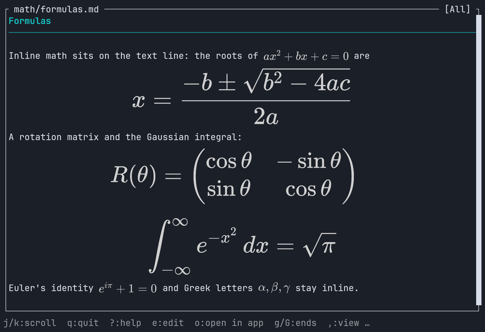

# konoma-math

The `math` plugin of [konoma](https://github.com/LESIM-Co-Ltd/konoma), a terminal file browser:
LaTeX formulas in Markdown drawn as pictures. The drawing itself is done by
[`konoma-math-core`](https://crates.io/crates/konoma-math-core).



*Screenshot taken in [konoma-markdown](https://github.com/LESIM-Co-Ltd/konoma-markdown); the standalone `konoma-math` program cannot open files.*

## You probably have it already

The plugin is built into konoma. Open a Markdown file with konoma and `$...$` and `$$...$$`
formulas are drawn; there is nothing to install. `konoma plugin install konoma-math` is refused
for that reason. `konoma plugin update konoma-math` is the command for taking a newer compatible
version of a built-in plugin, and rebuilds konoma.

For real pixels the terminal needs a graphics protocol (kitty graphics, iTerm2 or sixel);
otherwise images are approximated with half-block characters. See
[konoma's README](https://github.com/LESIM-Co-Ltd/konoma#readme).

Settings go in konoma's `config.toml`:

```toml
[plugins.math]
mode = "image"      # "text" keeps the LaTeX source as text
color = "#d0d0d0"   # glyph color; set a dark one on a light terminal
```

A `color` that is not a color, or is fully transparent, falls back to the default.

The plugin also declares ```` ```math ```` fences, but konoma 0.32.0 shows such a fence as a code
block. Use `$$...$$`.

## The `konoma-math` program

The crate also builds a program (`cargo install konoma-math`, Rust 1.92 or later). **It cannot
show any file.** The plugin only takes formulas embedded in Markdown, which a host has to extract
and hand over, so `konoma-math <file>` refuses every file, Markdown included. It cannot stand in
for the built-in plugin either: konoma does not load an external program whose id (`math`) is
already taken.

What it does do:

| Argument | Effect |
| --- | --- |
| `--help`, `-h` | Print the usage text. |
| `--version` | Print `math <version>`. |
| `--manifest` | Print what the plugin declares, as JSON. |
| `--serve` | Serve a konoma plugin host on standard input and output. |
| `--plugin math` | Names the plugin; optional, since the program carries only one. |

To see formulas, use konoma.

## As a library

`MathPlugin` and `math_manifest()` implement the
[`konoma-plugin`](https://crates.io/crates/konoma-plugin) interface. The default feature `app`
builds the program; depend with `default-features = false` to leave it out.

License: [MIT](https://github.com/LESIM-Co-Ltd/konoma-math/blob/main/LICENSE).
